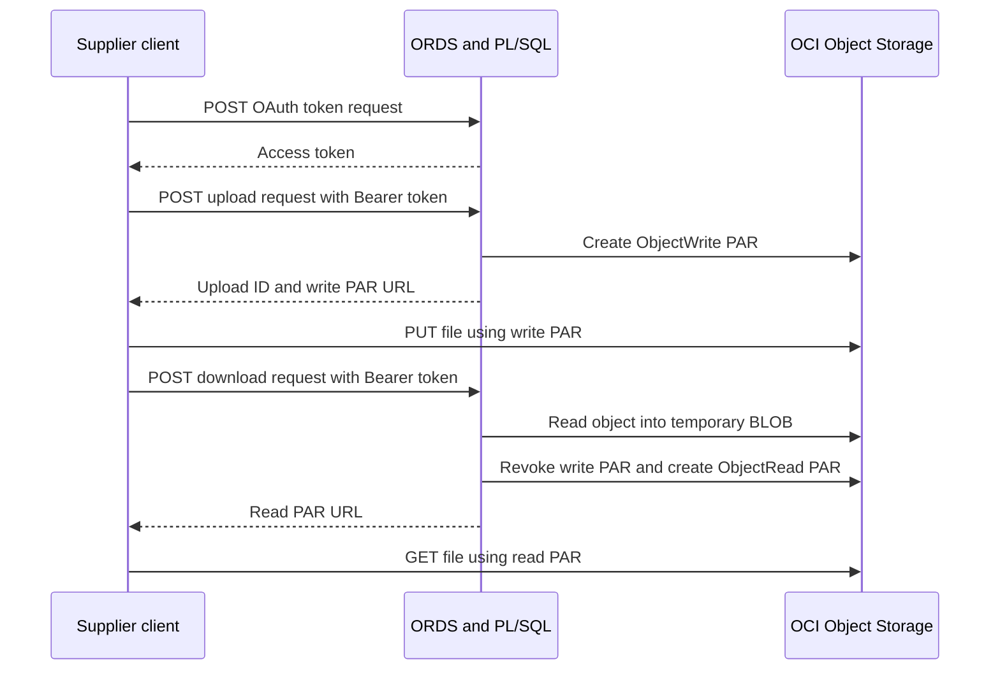

# OCI Object Storage and DIRECTORY files in Oracle Autonomous Database

This project explores how files can be stored and accessed from Oracle Autonomous Database, using a private OCI Object Storage bucket and a database `DIRECTORY`.

I started with small PL/SQL tests: writing and reading a local file, transferring files between a directory and a bucket, and reading an object directly into a BLOB. I then compared Resource Principal authentication, a credential backed by an OCI auth token, and pre-authenticated requests (PARs).

The final example simulates a supplier sending a file through temporary access issued by an API. The supplier authenticates with OAuth, requests a write PAR from ORDS, and uploads the file directly to Object Storage. A second API request returns a read PAR for downloading the same file.

## Environment

| Component | Lab configuration |
| --- | --- |
| Database | Oracle Autonomous AI Database Serverless, 26ai |
| OCI region | Frankfurt, `eu-frankfurt-1` |
| Application schema | `APP_DEV` |
| Administrative connection | `ADMIN`, for database setup and grants |
| Bucket | `adb-oci-storage-lab`, private |
| Database directory | `OCI_STORAGE_LAB_DIR` |
| REST layer | Oracle-managed ORDS |
| HTTP clients | PowerShell with `curl.exe` and Postman |

## What the tests demonstrate

| Test | Observed result |
| --- | --- |
| Write and read a directory file with `UTL_FILE` | The generated text was read back from `OCI_STORAGE_LAB_DIR` |
| Read a bucket object into a BLOB | `incoming/hello.txt` returned 57 bytes and the expected text |
| Download an object to a directory | The local file matched the source object in a byte comparison |
| Upload a directory file | `outgoing/from_directory.txt` was read back from the bucket with 63 bytes |
| Upload the same text from a BLOB | `outgoing/from_blob.txt` matched the directory-based upload byte for byte |
| Use manually created PARs | Write and read access were exercised separately |
| Read with an OCI auth-token credential | `OCI_STORAGE_LAB_CRED` read the sample object |
| Create a PAR from PL/SQL | The read PAR was created, used to read 57 bytes, and revoked |
| Complete the supplier flow | OAuth, PAR creation, direct upload and direct download succeeded |

The final download returned the expected text. The byte comparisons above belong to the earlier PL/SQL tests.

## Bucket, DIRECTORY or BLOB?

A bucket stores objects in OCI Object Storage. External applications can upload and download those objects over HTTPS, with access controlled through IAM or pre-authenticated requests (PARs).

A database DIRECTORY names a filesystem location accessible through database APIs. In Autonomous Database, it does not provide a public URL for uploading or downloading files. A BLOB holds binary data in a PL/SQL variable or a table column; an application can expose its contents through an API.

A directory is useful when an API needs a local file, such as UTL_FILE. An object can also be read into a BLOB or written from a BLOB without an intermediate directory file. In the final example, the supplier uploads and downloads the file directly through Object Storage URLs.

The [storage concepts](docs/storage-concepts.md) explain the differences, object-name prefixes, and additional uses for directories.

## Supplier file exchange

The client transfers the file directly to and from Object Storage. The download procedure also reads the small sample into a temporary BLOB before issuing the read PAR. The file is not copied into a `DIRECTORY` or stored in an application table during this flow.

The two application tables hold supplier identity and upload metadata. The HTTP requests are described in the [supplier flow](docs/supplier-flow.md).

## Project organisation

| Location | Content |
| --- | --- |
| `sql/` | Numbered SQL and PL/SQL scripts |
| `samples/` | Small input files, including `hello.txt` |
| `screenshots/` | Selected results from SQL, HTTP and OCI console tests |
| `docs/storage-concepts.md` | Storage choices and file handling |
| `docs/access-and-setup.md` | Database privileges, IAM and authentication |
| `docs/supplier-flow.md` | Application objects, manual HTTP requests and results |

The scripts progress from local file operations to bucket access and then to the supplier API. The HTTP requests were executed manually in PowerShell and Postman.

## Script sequence

| Script | Connection | Purpose |
| --- | --- | --- |
| [001_create_directory.sql](sql/001_create_directory.sql) | `ADMIN` | Create the directory and grant file access to the application schema |
| [002_write_local_file.sql](sql/002_write_local_file.sql) | `APP_DEV` | Write a small text file with `UTL_FILE` |
| [003_read_local_file.sql](sql/003_read_local_file.sql) | `APP_DEV` | Read the local file and list directory contents |
| [004_check_resource_principal.sql](sql/004_check_resource_principal.sql) | `ADMIN` | Check Resource Principal availability and the grant to `APP_DEV` |
| [005_read_bucket_object.sql](sql/005_read_bucket_object.sql) | `APP_DEV` | Read `incoming/hello.txt` into a BLOB |
| [006_download_object_to_directory.sql](sql/006_download_object_to_directory.sql) | `APP_DEV` | Copy the object to the directory and compare its bytes |
| [007_upload_directory_to_bucket.sql](sql/007_upload_directory_to_bucket.sql) | `APP_DEV` | Upload the generated directory file and read it back |
| [008_upload_blob_to_bucket.sql](sql/008_upload_blob_to_bucket.sql) | `APP_DEV` | Upload the same text from a BLOB and compare both objects |
| [009_create_oci_credential.sql](sql/009_create_oci_credential.sql) | `APP_DEV` | Create a credential backed by an OCI user auth token |
| [010_read_object_with_credential.sql](sql/010_read_object_with_credential.sql) | `APP_DEV` | Read the sample using that credential |
| [011_grant_oci_sdk.sql](sql/011_grant_oci_sdk.sql) | `ADMIN` | Grant access to the OCI PL/SQL SDK package and types |
| [012_create_par_plsql.sql](sql/012_create_par_plsql.sql) | `APP_DEV` | Create, test and revoke a read PAR from PL/SQL |
| [013_create_supplier_flow_tables.sql](sql/013_create_supplier_flow_tables.sql) | `APP_DEV` | Create the supplier and upload metadata tables |
| [014_create_storage_api.sql](sql/014_create_storage_api.sql) | `APP_DEV` | Create the package that issues upload and download PARs |
| [015_create_storage_ords.sql](sql/015_create_storage_ords.sql) | `APP_DEV` | Define the protected ORDS endpoints |
| [016_create_supplier_oauth_client.sql](sql/016_create_supplier_oauth_client.sql) | `APP_DEV` | Register the OAuth client and map it to Supplier A |

The bucket tests use [samples/hello.txt](samples/hello.txt), uploaded as `incoming/hello.txt`. Script `002` creates a separate local sample used by scripts `003`, `007` and `008`. Scripts `002` and `006` stop if their destination file already exists.

The [access and setup notes](docs/access-and-setup.md) describe the database grants, IAM statements and configuration values. The [supplier flow](docs/supplier-flow.md) contains the five manual Postman requests and links to their results.

## Main observations

- Database grants and OCI IAM policies control different parts of the access path.
- A bucket prefix is part of an object name, not a database directory.
- PL/SQL can work directly with object contents through a BLOB.
- PARs can be created programmatically and restricted to one object and one access type.
- In the supplier example, OAuth protects the API that issues PARs; each PAR then authorizes the corresponding Object Storage request.

## References

- [Oracle: managing directories in Autonomous Database](https://docs.oracle.com/en-us/iaas/autonomous-database-serverless/doc/create-manage-directory.html)
- [Oracle: DBMS_CLOUD subprograms](https://docs.oracle.com/en-us/iaas/autonomous-database-serverless/doc/dbms-cloud-subprograms.html)
- [Oracle: Resource Principal](https://docs.oracle.com/en-us/iaas/autonomous-database-serverless/doc/resource-principal.html)
- [Oracle: Object Storage pre-authenticated requests](https://docs.oracle.com/en-us/iaas/Content/Object/Tasks/usingpreauthenticatedrequests.htm)

